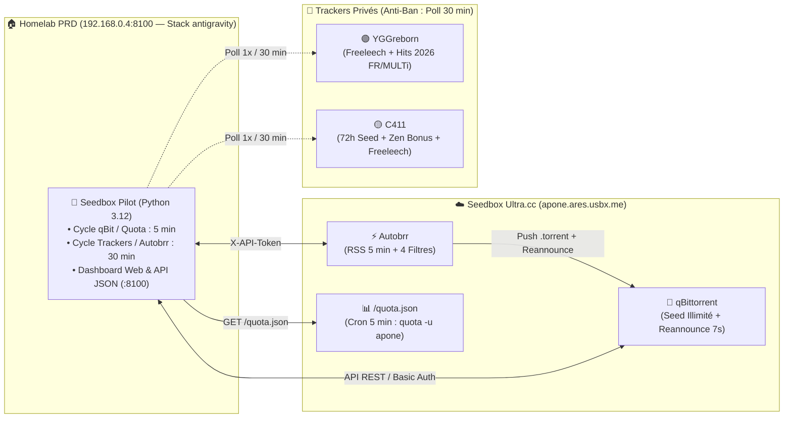

# 🚀 Seedbox Pilot — Optimisation Automatique de Ratio 24/7 (C411 & YGGreborn)

**Seedbox Pilot** est un démon autonome 24/7 conçu pour piloter une seedbox **Ultra.cc** (`qBittorrent` + `Autobrr` + `qui`) depuis un conteneur Homelab afin de **maximiser le ratio** sur **YGGreborn (`yggreborn.org`)** et **C411 (`c411.org`)**, tout en respectant strictement :
1. **Zéro risque de ban / rate-limit** sur les indexeurs (interrogation polie toutes les 30 minutes maximum, flux RSS espacés à 5 minutes).
2. **Zéro Hit & Run (H&R)** (protection stricte de la durée minimale de seed avant toute suppression).
3. **Préservation du quota d'upload Ultra.cc** (blocage DHT/PeX/LSD et suppression automatique des trackers publics parasites sur les torrents privés).

---

## 🔍 Diagnostic Initial & Correctifs Appliqués sur la Seedbox Ultra.cc

L'audit complet de la seedbox (`apone.ares.usbx.me`, offre `Spirit-v2` 2000 Go / 4 To upload mensuel) a révélé **5 causes majeures** qui sabotaient le ratio :

| # | Problème identifié sur Ultra.cc | Impact sur C411 & YGGreborn | Correctif appliqué |
|---|---|---|---|
| **1** | `qBittorrent.conf` avait `MaxRatio=1.5`, `MaxRatioAction=3` (**Suppression du torrent ET des fichiers !**) et `GlobalMaxSeedingMinutes=1380` (**23h**) | 🔴 **Critique** : Supprimait tous les torrents au bout de 23h (alors que **C411 exige 72h de seed minimum** !) et plafonnait les torrents rentables à 1.5 de ratio au lieu de les laisser monter à 10.0+. | Désactivation totale des limites globales et par torrent (`max_ratio_enabled=false`, `max_seeding_time_enabled=false`). C'est désormais `seedbox-pilot` qui gère l'espace disque intelligemment. |
| **2** | **34 torrents bloqués à `0%` (`stalledDL`)** sur C411 avec erreur `403 Forbidden` | 🟠 **Élevé** : C411 bloque le téléchargement (`minRatioForDownload: 0.90`) tant que le ratio global est `< 0.90`, mais **autorise le seed** des torrents 100 % complétés. Ces 34 torrents morts encombraient la file et spammaient le tracker. | Purge automatique des téléchargements bloqués à `0%` en `Forbidden` / `Torrent removed` et maintien des **36 torrents 100 % complets** en seed permanent. |
| **3** | Filtres Autobrr trop larges (`10/HOUR` sans filtre de langue/année, acceptant vieux torrents et VOSTFR peu demandés) | 🟠 **Élevé** : Téléchargement de fichiers sans leechers (ratio `< 0.2`) qui consommaient du download sans jamais rembourser. | Remplacement par **4 filtres Autobrr chirurgicaux** : priorité absolue au **Freeleech** (`0 Go` compté en DL, `100 %` en UP) + **Sorties 2026 FR/MULTi** (`1080p/2160p`, `reannounce 7s x 20`). |
| **4** | Trackers publics parasites (`nyacat.pw`, `zhuqiy.com`, etc.) présents sur certains torrents YGG + `LSD=true` | 🟡 **Moyen** : Fuite de trafic d'upload hors-tracker non comptabilisé et risque de fuite de passkey. | Désactivation `DHT/PeX/LSD` via API et suppression automatique des URLs de trackers publics par `seedbox-pilot`. |
| **5** | Absence de télémétrie du quota utilisateur réel (`quota -u apone`) | 🟡 **Moyen** : `df` sur Ultra.cc affiche la partition partagée (`/home23`) et non le quota personnel de `1863 GiB`. | Installation d'un cron `/home/apone/update-quota-json.sh` exposant `https://apone.ares.usbx.me/quota.json` (protégé par Basic Auth). |

---

## 🧠 Architecture & Stratégie de Maximisation du Ratio



### 1. Règles d'Or Spécifiques aux 2 Trackers

#### 🟢 YGGreborn (`yggreborn.org`)
- **État initial** : Ratio **1.39** (`1.57 To` Upload / `1.13 To` Download + `3.68 To` téléchargés en Freeleech sans impact sur le download).
- **Stratégie** :
  - **Filtre `#6` (`YGG - Freeleech Priority`, Priorité 20)** : Capture immédiatement les nouveaux torrents `Freeleech` (`300 MiB` – `30 GiB`, max `3/heure`). Chaque Go envoyé est du **100 % profit net** sur le ratio.
  - **Filtre `#2` (`YGG - 2026 Hits FR/MULTi`, Priorité 5)** : Capture uniquement les nouveautés de l'année **2026** en `1080p`/`2160p` avec tags `*MULTi*, *FRENCH*, *VFF*, *VF2*, *TRUEFRENCH*` (en excluant `*VOSTFR*, *Fansub*`), taille `700 MiB` – `16 GiB`, max `2/heure`. Ce sont les releases où l'essaim initial (swarm) garantit un ratio `> 1.5` dès les premières heures.
  - **Sécurité Ratio** : Si le ratio YGGreborn descendait sous `1.10`, `seedbox-pilot` mettrait automatiquement en pause le filtre `#2` (`Paid`) pour ne laisser actif que le filtre `#6` (`Freeleech`).

#### 🟡 C411 (`c411.org`)
- **Règles officielles du tracker (extraites de `/api/settings/public`)** :
  - `minRatioForDownload: 0.90` : En dessous de `0.90` de ratio, le tracker renvoie `403 Forbidden` sur les nouveaux téléchargements (`left > 0`), mais **accepte toutes les annonces de seed** (`left = 0`, `status: Working`).
  - `minSeedtimeHours: 72` ou `exemptRatioAbove: 2.0` : Tout torrent téléchargé **doit rester en seed au moins 72 heures** (ou atteindre un ratio de `2.0`) sous peine de Hit & Run.
  - **Système Zen (Seedbonus)** : Chaque heure passée en seed sur les torrents complets génère des points **Zen** échangeables dans la boutique (`https://c411.org/shop`) contre des **Go d'upload** pour remonter le ratio au-dessus de `0.90`.
- **Stratégie** :
  - **Conservation à 100 % des torrents C411 en seed** pour accumuler de l'upload réel + des points Zen H24.
  - **Filtre `#7` (`C411 - Freeleech Priority`, Priorité 20)** : Actif.
  - **Filtre `#3` (`C411 - 2026 Hits FR/MULTi`, Priorité 5)** : Maintenu en pause automatique par `seedbox-pilot` tant que le compte C411 est en mode récupération (`< 1.00`), puis activé automatiquement dès que le ratio C411 repasse au-dessus de `1.00`.

### 2. Garbage Collector Intelligent (Gestion des 2000 Go Ultra.cc)
- **Sous 82 % d'occupation disque (`< 1527 Go`)** : **Aucune suppression**. Plus vous gardez de torrents en seed simultané, plus vous gagnez d'upload long-terme et de points Zen.
- **Au-dessus de 82 % d'occupation disque** : `seedbox-pilot` libère de la place jusqu'à redescendre à **75 %** en supprimant **uniquement** les torrents qui :
  1. Ont **validé leur obligation Hit & Run** (`>= 74h` de seed ou `ratio >= 2.1` sur C411 / `>= 1.5` sur YGG).
  2. Ont le **score de rentabilité auto-adaptatif** le plus faible (pondéré par le poids appris de la catégorie et un bonus $\times 2.5$ pour protéger les torrents C411 générateurs de Zen).

### 3. 🧠 Moteur d'Auto-Apprentissage & d'Auto-Adaptation (`RatioLearner`)
À chaque cycle de 5 minutes (sans aucune requête supplémentaire vers les trackers), `seedbox-pilot` enrichit une mémoire persistante (`torrent_ledger.json` + `learning_state.json`) et adapte automatiquement la stratégie :
1. **Profilage ROI par Catégorie, Tranche de Taille et Team (`Release Group`)** :
   - Mesure le ROI réel ($\text{Upload} / \text{Download}$), le gain net de buffer ($\text{UP} - \text{DL}_{\text{payant}}$) et le taux de succès ($\text{ratio} \ge 0.85$) pour chaque segment (`movie_1080p`, `episode_tv`, `season_pack`, `movie_4k`, `sport_event`, `tv_raw_ts`).
2. **Auto-Blacklist des Teams & Formats Déficitaires (`except_releases`)** :
   - Toute Team ayant $\ge 2$ torrents matures ($\ge 5\text{h}$ de seed) avec un $\text{ROI} < 0.45$ et une perte nette de buffer $\le -2.5\text{ Go}$ (ex. `*-T3KASHI*`, captures TV `*.ts`, `*Essais.Libres*`) est **automatiquement ajoutée aux exclusions** des filtres payants Autobrr (`#2` et `#3`), tout en restant autorisée sur les filtres `Freeleech` (`#6` et `#7`).
3. **Auto-Calibration du Plafond de Taille (`max_size`)** :
   - Ajuste dynamiquement `max_size` sur les filtres payants (`8GiB`, `9GiB`, `14GiB`) selon la rentabilité mesurée des gros fichiers `> 12 Go` vs `6-12 Go`.
4. **Frein Anti-Dilution en Temps Réel (`unrepaid_dl_debt_6h_gb`)** :
   - Calcule la dette de download non encore remboursée sur les torrents payants des 6 dernières heures. Si cette dette dépasse `12 Go`, les filtres payants passent automatiquement en pause le temps que l'essaim rembourse le download, laissant les filtres **Freeleech** tourner à 100 %.
5. **Rétention & Nettoyage Strict des Logs (`RETENTION_DAYS=30`)** :
   - Sur le modèle exact de `telemetry-collector`, `prune_and_count_jsonl()` purge automatiquement au démarrage et toutes les 6h les entrées de plus de 30 jours dans `telemetry.jsonl`, `stats_history.jsonl` et `pilot_events.jsonl`.

---

## 🖥️ Dashboard Web & API (`http://192.168.0.4:8100`)

Le conteneur expose un tableau de bord temps réel Dark Mode et une API REST :
- **Dashboard Web** : `http://192.168.0.4:8100/`
- **État complet JSON** : `http://192.168.0.4:8100/api/status`
- **État du moteur d'apprentissage** : `http://192.168.0.4:8100/api/learning`
- **Healthcheck Docker & Rétention Logs** : `http://192.168.0.4:8100/healthz`
- **Cycle immédiat (POST)** : `curl -X POST http://192.168.0.4:8100/api/run`

---

## 🛠️ Installation & Déploiement

### 1. En local ou via Docker Compose standard
```bash
git clone https://github.com/juli1guellec/seedbox.git
cd seedbox
cp .env.example .env
# Renseignez vos identifiants dans .env
docker compose up -d --build
```

### 2. Déploiement Homelab (Stack `antigravity` dans Dockhand)
Le service tourne H24 dans la stack `antigravity` sur `192.168.0.4` (`port 8100:8080`), avec ses données persistantes dans `/appdata/antigravity/seedbox`.

---

## 🔑 Astuce Optionnelle pour C411 (Affichage des points Zen dans le Dashboard)
Sur C411, la clé API Torznab actuelle possède uniquement la permission `torznab:read`. Si vous souhaitez que `seedbox-pilot` affiche également votre solde exact de **points Zen** en direct :
1. Rendez-vous sur `https://c411.org/user/integrations` (ou Paramètres → Clés API).
2. Créez ou cochez la permission **`profile:read`** sur votre clé API et mettez à jour `C411_API_KEY`.
